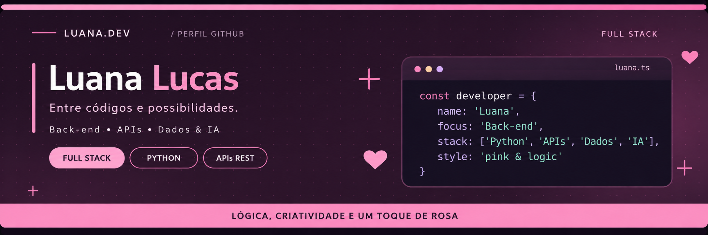
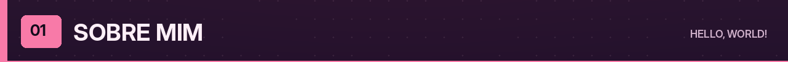
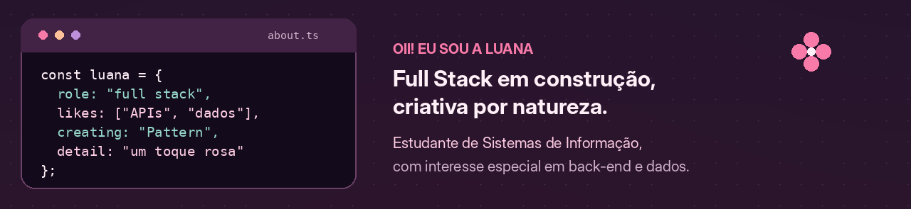
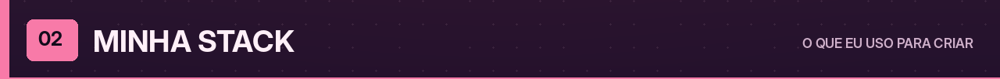
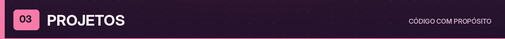
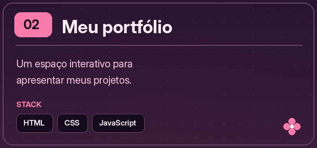
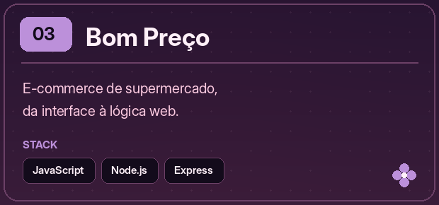
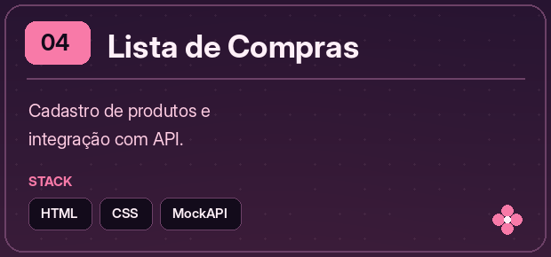
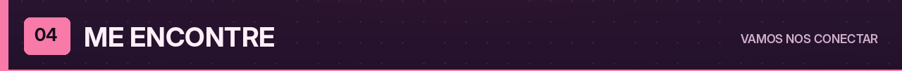
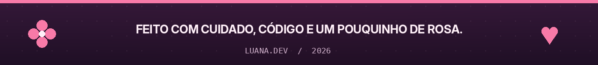

 

 &nbsp; 

 
 

Gosto de entender o que acontece **por trás das interfaces** e transformar ideias em projetos que funcionam de ponta a ponta. Tenho interesse em **APIs, integração entre sistemas, automação, dados e IA generativa**. Atualmente, também estou desenvolvendo o **Pattern**, meu projeto de organização e produtividade.

 

**Outras ferramentas que fazem parte dos meus estudos e projetos:** Express, SQLite, Pandas, SQLAlchemy, Pydantic, Pytest, Docker e VS Code.

 

 

 

 

 

 
 

**Meus projetos contam um pouco do que eu gosto de construir. Quer ver mais?**

 

 &nbsp; 

 
 

